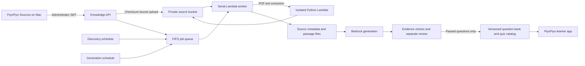

# Growing the PiyoPiyo library

PiyoPiyo Sources 1.0.1 (2) is installed at `/Users/rumpology/Applications/PiyoPiyo Sources.app`. Its mint-and-teal book icon distinguishes it from the main PiyoPiyo app. Sign in with the same Apple account used in PiyoPiyo. Only members of the app's `content-admins` group can use this library; ordinary learner accounts cannot read originals or submit sources. The owner's existing Apple account has this permission. The app stores its own login in Keychain and never needs an AWS profile.

Choose **Add source** to submit a public HTTPS URL or select a PDF, TXT, or Markdown file. Files can also be dropped onto the window or opened with PiyoPiyo Sources. Give the source a useful title and topic, then confirm cloud processing. Source titles and public URLs can appear in learner citations; uploaded originals and evidence excerpts stay private. Submit only material you are permitted to process, without secrets or personal records.

The source list shows processing status, extracted passage counts, and errors. **Reprocess** retries an import; **Pause source** stops that source from being used for future generation. The header provides **Pause pipeline**, **Find new sources**, and **Make a quiz now**. An individual ready source also has **Make questions**. Select a question batch to inspect its answers and validation results. Right-click a published batch and choose **Withdraw from future quizzes** to remove it from the learner catalog. Withdrawal preserves historical question records so saved attempts can still be scored. Learner caches may retain the previous catalog until their next refresh.

## Schedule and behavior

| Work | Schedule in America/Lima | Scope |
| --- | --- | --- |
| Discovery and refresh | Monday, Wednesday, Friday at 09:30 | One arXiv CS feed query, at most three new abstracts, and up to two URL refreshes that are at least seven days old |
| Question generation | Monday, Wednesday, Friday at 10:30 | One ready source, up to three new multiple-choice questions, followed by a separate strict review |

The cloud runs these jobs even when both Mac apps are closed. New sources are processed as soon as they are submitted. Generation rotates through sources and advances through their passages; whole textbooks are not consumed in a single model request. Existing published questions are preserved. New batches appear under **Library → Fresh quizzes** in PiyoPiyo 1.1.0. Signed-in learner apps refresh their question bank and quiz catalog at most hourly and cache them for offline use.

“Learning” here means adding and refreshing a source corpus and generating practice from it. The pipeline does not retrain model weights or feed learner answers into content generation. The initial automated discovery source is arXiv CS; owner-submitted books, documentation, and articles broaden its coverage. arXiv discovery reads abstracts, not arbitrary full papers. Research claims must be attributed and qualified. This is bounded discovery, not an unrestricted web crawler.

## Data flow



Sources are deduplicated by normalized URL or SHA-256 file hash, and again by extracted content hash. PDFs retain page numbers; passages have IDs, offsets, and hashes. Drafts, review decisions, exact evidence excerpts, and batch status remain in private storage. Native uploads use short-lived signed S3 requests with a required SHA-256 checksum and size. URL retrieval requires HTTPS, checks robots rules on redirects, rejects private IPs, and pins validated DNS answers during each connection.

Generation and review use a dedicated PiyoPiyo Haiku 4.5 inference profile through Amazon Bedrock in US regions. Source text is treated as untrusted reference data. Publication requires valid question structure, an exact evidence quote from a supplied passage after whitespace normalization, duplicate checks, self-contained wording, and a separate model review of accuracy, clarity, originality, and relevance. A rejected batch publishes nothing unless individual questions passed all checks. Automated reviews are useful gates, not a guarantee of correctness; the batch inspector and withdrawal control remain available.

S3 conditional writes preserve concurrent changes. Stable question IDs and saved draft/review checkpoints make retries idempotent. The FIFO worker processes one job at a time. Transient service failures retry up to three deliveries and then go to the dead-letter queue; permanent content failures remain visible in Activity for correction. Known quota failures stop without consuming repeated inference attempts.

## Cost and limits

- Existing total app budget: **$15/month**, with the previously configured owner email alerts. Alerts are not a hard spending ceiling.
- Hard generation limit: **60 attempted model calls per UTC calendar month**, reserved atomically before invocation. Generating and reviewing a normal batch uses two calls. Failed model attempts also count. The quota resets through a new monthly usage record.
- Each model request has at most 20,000 bytes of source/question input plus a fixed system prompt; generation output is capped at 2,200 tokens and review at 1,000. Model SDK retries are disabled so the quota counts every attempted invocation.
- Each import is at most 20 MB, 1,000 PDF pages, and four million extracted characters. The library accepts up to 500 sources. PDFs must contain selectable text; password-protected or scanned-only PDFs need local preparation first. There is no paid OCR service.
- Three on-demand Lambdas, one FIFO queue and DLQ, private S3, and an on-demand DynamoDB table. No EC2 instance, NAT gateway, provisioned model endpoint, vector database, or continuously running worker.
- Runtime concurrency is one per knowledge function, table writes are capped at five request units per second, logs expire after seven days, noncurrent S3 versions after fourteen days, and job records after ninety days. Sources and batch evidence persist until an administrator deliberately manages them.

Model prices and total AWS charges can change. Use the [Amazon Bedrock pricing page](https://aws.amazon.com/bedrock/pricing/) and the dedicated `piyopiyo-knowledge-generation` profile to track this feature separately. All new resources carry `Project=PiyoPiyo`; none are shared with unrelated apps. Pause processing in Sources to stop future model work. An invocation already in progress may finish and be billed; the worker checks the pause setting again before publication.

## Operations and deployment

Infrastructure lives in `infra/knowledge.ts`, attached to the existing `PiyoPiyoDev` stack. Runtime code is under `backend/knowledge` and `backend/pdf`; the native administrator app is under `SourcesDesk`. Build artifacts use content-addressed S3 keys in the existing private deployment bucket.

```sh
npm run typecheck
npm run synth
npm test
.venv/bin/python backend/pdf/test_extract.py
.venv/bin/cfn-lint cdk.out/PiyoPiyoDev.template.json
node scripts/deploy.mjs
# Inspect the prepared CloudFormation change set, then:
node scripts/deploy.mjs --execute
```

Deploy with the authorized `admin` profile via `scripts/aws.sh`. For expired SSO credentials, use `aws sso login --profile admin`. Do not replace the published bank with the original local seed file; that would discard later cloud-generated additions.

To publish authored questions, run `python3 scripts/build_questions.py` (it also refreshes the bundled `Resources/questions.json`), then merge into the live bank:

```sh
AWS_PROFILE=admin AWS_REGION=us-east-1 node scripts/publish-questions.mjs --dry-run
AWS_PROFILE=admin AWS_REGION=us-east-1 node scripts/publish-questions.mjs
```

The script merges by question id. Authored rows replace their published copies, retired rows stay retired, and generated or other published-only rows are kept. The write is conditional on the ETag it read and retries if the pipeline published in the meantime. `--dry-run` prints the merge counts without writing.

The knowledge table is `PiyoPiyoKnowledge`; the bucket is `piyopiyo-knowledge-992680757326`. Logs are `/aws/lambda/piyopiyo-knowledge-api`, `/aws/lambda/piyopiyo-knowledge-worker`, and `/aws/lambda/piyopiyo-knowledge-pdf`. The Scheduler group is `piyopiyo-knowledge`. The dead-letter alarm is visible in CloudWatch; errors also appear in the native Activity view. This alarm has no separate email subscription. Existing budget alerts remain unchanged.

Use `scripts/knowledge-integration.mjs` for a live test with a disposable email-suppressed administrator. It removes the test identity afterwards while intentionally retaining useful imported sources and validated content. `--generation-pdf --seed` also checks the textbook and documentation seed imports. Never log tokens, signed upload URLs, or private key material. Originals are private reference material and are not included in learner downloads or app bundles.

The [$15 budget is monitored with AWS Budgets](https://docs.aws.amazon.com/cost-management/latest/userguide/budgets-managing-costs.html). Schedule semantics follow [EventBridge Scheduler timezone rules](https://docs.aws.amazon.com/scheduler/latest/UserGuide/schedule-types.html); PDF text extraction uses [pypdf](https://pypdf.readthedocs.io/en/stable/user/extract-text.html).
